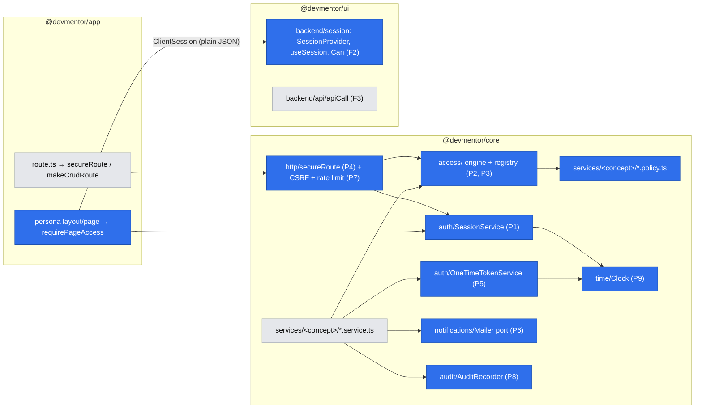
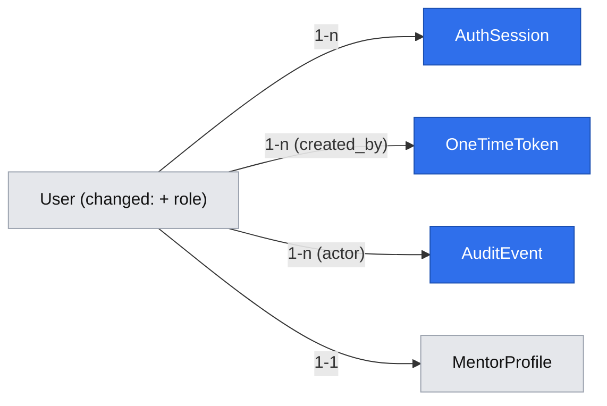

# Access Framework and Authentication Security Foundation

> Source: epic #15 (E01), split per gate answer Q1. Consumer spec:
> `.ai/specs/2026-10-20-accounts-and-roles.md` (sign-in flows, role screens).
> Design authority: `.ai/specs/product-brief.md`. Engineering law:
> `.ai/specs/2026-09-01-engineering-standards.md`, `BACKWARD_COMPATIBILITY.md`.

## 📝 TLDR

Every story in E02–E05 needs the same four answers — *who is calling, may this role do
this action, does this row belong to them, which rows may they list* — and today the code
answers none of them (`readSession` returns `null`; `requireRole`/`assertOwnership` are
unused; no CSRF check). **Proposed (future behavior):** a small, code-declared
authorization framework in `@devmentor/core` plus matching UI primitives in
`@devmentor/ui`/`app`, so a concept declares its access rules once in a `*.policy.ts`
file and routes, services, pages, navigation, and client affordances use the same action
ids. A separate authentication/security foundation in `@devmentor/core` supplies the
shared sessions, one-time tokens, mail, rate limiting, audit, and clock contracts without
making domain policies depend on those integrations.

## 📝 Problem Statement

- **Every feature needs identity + access, and the backlog repeats the same shapes.**
  Extracted from #16–#42 (full matrix in *Backlog-derived requirements*): owner-only
  mutation in 7 stories, participant-only reads in 6, scoped lists in 4, public-read /
  owner-write in 2, data-dependent capability checks in 3, one-time tokens in 3,
  operator actions with recorded outcomes in 3.
- **Hand-written checks drift.** With ~20 routes written one story at a time, the first
  forgotten `where menteeId = me` is a cross-user data leak; the standards spec already
  treats a missing ownership check as a blocker, but nothing makes it hard to forget.
- **Contracts are cheapest now.** `Role`, the `devmentor_session` cookie, and the CSRF
  header (`BACKWARD_COMPATIBILITY.md` §7) become breaking surfaces "once auth ships".

## 📝 Proposed Solution

**One declarative policy per concept is the single source of truth for access.** Routes,
services, pages, navigation, and client affordances all reference an action from the
same declaration; raw role arrays are not accepted by route or page guards. Two
enforcement layers use it:

1. **Route guard (coarse, early):** resolves the principal, enforces CSRF + rate limit,
   and asks "can this *role* ever perform this action?" before any service runs.
2. **Service (fine, authoritative):** every service method that touches user data takes
   `actor` as its first argument and calls `access.authorize(actor, action, row)` on the
   loaded row, or `access.scope(actor, action)` for lists. Server components that call
   services directly are therefore protected too (the Next.js "data access layer" rule).

### Resolved decisions (gate answers)

| # | Decision |
|---|---|
| Q1 | Split: this spec = framework; `2026-10-20-accounts-and-roles.md` = E01 feature. |
| Q2 | **Static, code-declared policy** (no DB tables, no admin UI). The standards spec's "no RBAC" is amended to "no *dynamic* RBAC" (Phase 1, Step 1). |
| Q3 | **Single role per user** (`mentee` \| `mentor` \| `operator`). A founder who also mentors uses two accounts. |
| Q4 | Role value **`mentee`** replaces `student` everywhere. |
| Q5 | **DB-backed opaque sessions**, token hashed at rest, revocable. |
| Q6 | **Thin in-house layer**: `bcryptjs` + `node:crypto`; OAuth behind a port with plain `fetch` (see accounts spec — `arctic` dropped because endpoint override for the fake-GitHub test server could not be verified; ⚠ overridable). |
| Q7 | Build **P1–P9**. Defer settings, state-machine, and money designs to their owning epics; build the small clock port now so time-based security code has no planned migration. |
| Q8 | **Audit trail from day one**, append-only, no UI in E01. |

### Alternatives considered

- **Bare `requireRole` + `assertOwnership` per route (status quo).** Lost: the check and
  the list filter are written separately and drift; nothing makes a missing check visible.
- **DB-backed RBAC** (roles/permissions tables, admin UI). Lost: no product need
  (D19: operator = two founders), excluded by standards.
- **CASL** (closest market analogue: isomorphic abilities compiled to DB filters).
  Lost: no MikroORM adapter, larger surface than our three action kinds; we copy its
  *idea* (one rule → item check **and** query filter).
- **Pundit-style per-resource policy classes** (Rails). We adopt its two-method shape
  (`authorize` + `policy_scope`) and its `verify_authorized` safety net (every route must
  declare `access`), but as data, not classes (standards: composition over inheritance).
- **Oso / Cerbos** (external policy engines). Lost: a network/sidecar dependency for
  three roles.
- **Stateless JWT** (standards' original suggestion). Lost per Q5: invitation acceptance
  (E02-S01) and operator removal change roles mid-session; DB sessions make that
  immediate and give sign-out-everywhere for free. Lucia's/The Copenhagen Book's session
  guidance (random 256-bit token, SHA-256 at rest, sliding idle expiry) is followed.

## 📝 Architecture



Takeaway: authorization decisions resolve through `access/` and the concept's
`*.policy.ts`; authentication/security services are sibling infrastructure rather than
dependencies of the policy engine. `app` only wires them, `ui` only consumes a
serialised projection, and the dependency direction `app → core → db`, `ui` standalone,
is unchanged.

### File placement

| Primitive | Location |
|---|---|
| Roles constant | `packages/db/src/entities/auth/roles.ts` (`STORED_ROLES`) — db is the leaf and the column needs the values; `core/src/access/roles.ts` adds `operator` and exports `Role` |
| Engine (P2, P3) | `packages/core/src/access/{policy,rules,scope,registry,principal}.ts` |
| Concept policies | `packages/core/src/services/<concept>/<concept>.policy.ts` (first: `auth/user.policy.ts`, `audit/audit.policy.ts`) |
| Sessions (P1) | `packages/core/src/services/auth/session.service.ts` |
| Route guard (P4) | `packages/core/src/http/secureRoute.ts`; `auth.ts` reworked; `csrf.ts` |
| Tokens (P5) | `packages/core/src/services/auth/one-time-token.service.ts` |
| Mailer (P6) | `packages/core/src/services/notifications/mailer.port.ts` + `adapters/{log,file}-mailer.ts` |
| Rate limit (P7) | `packages/core/src/http/rate-limit/{rate-limiter.port,memory-rate-limiter,policies}.ts` |
| Audit (P8) | `packages/core/src/services/audit/audit-recorder.service.ts` |
| Clock (P9) | `packages/core/src/time/{clock.port,system-clock}.ts` |
| Safe redirect | `packages/core/src/validators/auth/return-to.schema.ts` |
| Page guard (F1) | `packages/app/src/lib/access.ts` |
| Client session (F2, F4) | `packages/ui/src/backend/session/{SessionProvider,useSession,Can,RoleNav}.tsx` + `types.ts` |

`access/` is framework infrastructure like `http/` and `events/`, not a domain concept.

## 📝 Backend primitives

### P1 — Principal & sessions

```ts
// core/src/access/principal.ts
export interface Principal {
  userId: string;
  role: Role;
  sessionId: string;
  displayName: string;
  avatarUrl: string | null;
}
/** @deprecated alias kept one PR for BC §2; use Principal (avoids clash with mentoring "sessions", E04). */
export type Session = Principal;
export type Actor = Principal | null; // null = anonymous
```

`SessionService` (scoped, registered as `sessionService`):

| Method | Behavior |
|---|---|
| `create(user, { method })` | 32 random bytes → base64url token; stores `sha256(token)`; returns `{ token, cookie }` (Set-Cookie string). Audits `auth.session.created` (`{ method, role }`) in the same flush. |
| `resolve(token)` | Hash lookup, joined user; slides `idleExpiresAt` when `lastSeenAt` is older than 1 h (bounded write rate). Returns a discriminated result: `{ status: 'valid', principal }` · `{ status: 'invalid' }` (unknown, revoked, expired → caller clears the cookie) · `{ status: 'unavailable' }` (DB error → treat as anonymous, **do not** clear the cookie). **The role is computed on every request** by the `roleResolver` Cradle hook (default: `users.role`; the accounts spec plugs in the operator allowlist), so role changes take effect immediately. |
| `revoke(sessionId)` / `revokeAllForUser(userId, reason)` | Sets `revokedAt`; audits. |
| `clearCookie()` | Expired Set-Cookie. |

Inside `secureRoute` and `requirePageAccess`, the session is resolved with the
**current** scope's `sessionService` (one `EntityManager` per request — no nested
scope). The standalone `readSession(req)` export opens its own scope only for legacy
callers.

Constants (named, with the why): `SESSION_IDLE_TTL = 24h` (standards' 24 h expiry, now
sliding), `SESSION_ABSOLUTE_TTL = 7d` (forces re-auth weekly; no refresh-token flow),
`SESSION_TOUCH_INTERVAL = 1h`. Time comes from the P9 `Clock`. Cookie:
`devmentor_session`, `httpOnly`, `secure` from the validated app environment's
`isProduction` value, `sameSite=lax` (OAuth callback is a cross-site top-level GET),
`path=/`, `Max-Age` = absolute TTL.

`readSession(req)` keeps its exported signature (BC §2) and maps `valid` → principal,
anything else → `null` (+ a `warn` log for `unavailable`) — fail closed, and the app
still boots and builds without a database.

### P2 — Access policy

The policy vocabulary has three explicitly declared action kinds:

```ts
// core/src/services/auth/user.policy.ts — first real policy
export const userPolicy = defineAccessPolicy({
  'auth.area.mentee': roleAction(['mentee']),
  'auth.area.mentor': roleAction(['mentor']),
  'auth.area.operator': roleAction(['operator']),
  'auth.session.sign-out': roleAction(['mentee', 'mentor', 'operator']),
  'auth.user.list': collectionAction<User>([
    scopeGrant(['operator'], () => ({})),
  ]),
  'auth.user.read': itemAction<UserDto>([
    grant(['operator']),
    grant(['mentee', 'mentor'], ({ actor, row }) => row.id === actor.userId),
  ]),
  'auth.user.update-self': itemAction<UserDto>([
    grant(['mentee', 'mentor', 'operator'], ({ actor, row }) => row.id === actor.userId),
  ]),
});
```

`roleAction` has no row. `itemAction` uses typed predicates over `{ actor, row }`.
`collectionAction` uses typed `scopeGrant` functions that return MikroORM
`FilterQuery<T>` values. There are no string relation paths to interpret or keep in
sync with entity refactors.

Illustrative future policy (owned by E03 — shown only to prove the vocabulary covers it):

```ts
export const bookingPolicy = defineAccessPolicy({
  'bookings.booking.list': collectionAction<Booking>([
    scopeGrant(['mentee'], actor => ({ mentee: actor.userId })),
    scopeGrant(['mentor'], actor => ({ mentor: actor.userId })),
    scopeGrant(['operator'], () => ({})),
  ]),
  'bookings.booking.cancel': itemAction<Booking>([
    grant(
      ['mentee'],
      ({ actor, row }) => row.mentee.id === actor.userId && row.status === 'confirmed',
    ),
  ]),
});
```

**Engine API** (`core/src/access/policy.ts`, exposed as the `access` Cradle singleton):

| Function | Semantics |
|---|---|
| `access.canRole(actor, action)` | True if the action has any grant matching the actor's role (or `anyone`). Used by the route guard and by `ClientSession.capabilities`; it is only a coarse check for item actions. |
| `access.can(actor, action, row?)` | Evaluates a role action or an item action's typed predicates. Collection actions are rejected here. |
| `access.authorize(actor, action, row?)` | `can` or throw: anonymous → `UnauthorizedError` (401); otherwise `ForbiddenError` (403, generic message — never says which rule failed). |
| `access.scope(actor, action)` | Evaluates a collection action's matching scope grants and combines their returned `FilterQuery` values under `$or`; no grant → 403. Role and item actions are rejected. Internal — services call `access.restrict` (P3). |
| `access.allowedActions(actor, row, actions)` | `string[]` for DTOs (`allowedActions: ['bookings.booking.cancel']`) so UI buttons follow the same rules as the server. |

Invariants (each has a unit test):

- **Fail closed:** unknown action or a throwing predicate/scope function → deny (and
  `error` log for programmer errors).
- **Action kind is checked at definition and use:** `defineAccessPolicy` records
  `role`, `item`, or `collection`; registration rejects malformed grants, and runtime
  rejects `scope()` on non-collection actions or `can()` on collection actions.
- **Typed action ids:** `registry.ts` explicitly lists every policy (no globbing, per
  "explicit over implicit"); `AccessAction` is the union of their keys, so a typo is a
  compile error. Ids follow `concept.entity.action` (same as event ids).
- **Typed predicates and filters:** entity/property mistakes are compile errors rather
  than missing-path runtime denials.

### P3 — Scoped queries

Services build lists through one helper that makes overriding the scope impossible:

```ts
const where = access.restrict(actor, 'bookings.booking.list', validatedFilters);
// → { $and: [ <compiled scope>, validatedFilters ] }   — never an object spread
const rows = await em.find(Booking, where, { orderBy, limit, offset });
```

Spreading (`{ ...scope, ...filters }`) would let a filter key such as `mentee` or `$or`
replace the ownership condition — a cross-user read. `restrict` always nests under
`$and`; a regression test passes filters that try to override ownership. Rule for
reviewers (added to the standards checklist in Step 1): **a list method without
`access.restrict` or an explicit operator-only `authorize` is a blocker.**

### P4 — Route guard, CSRF, and `makeCrudRoute`

```ts
// core/src/http/secureRoute.ts — the one way to write a non-CRUD route
export const POST = secureRoute({
  access: 'bookings.booking.cancel',          // or publicAccess('why this is public')
  body: bookingCancelSchema,                   // optional zod; 422 on failure
  rateLimit: { policy: 'auth.login', key: ({ ip, body }) => `${ip}:${body.email}` }, // optional
  csrf: 'required',                            // default for non-GET; 'skip:<reason>' for signed webhooks (E03)
  handler: ({ actor, cradle, body, params, req }) => cradle.bookingService.cancel(actor, params.id, body),
});
```

Order inside the wrapper (built on `apiHandler`, inside one `withScope`): CSRF → parse
and validate the optional body → resolve actor with the scope's `sessionService` →
rate limit using the validated body → `access.canRole` (coarse) → handler. This makes
identity-based keys such as normalized email available to the limiter. Returned
`Response` objects still pass through (redirects, Set-Cookie); an `invalid` session
result appends the cookie-clearing header to any response.

- **CSRF (`csrf.ts`):** for `POST/PUT/PATCH/DELETE`, require `x-devmentor-request: 1`
  (sent by `apiCall`) **and**, when an `Origin` header is present, `Origin === APP_URL`
  origin. Failure → 403 `forbidden`. GET handlers must be side-effect free, except
  OAuth handshake and token-verification routes; those may set/clear short-lived
  cookies or consume provider state and are protected by their own state/token.
- **`makeCrudRoute`:** `authorize` is replaced by a **required** `access` option
  `{ list?, get?, create?, update?, delete? }` (action id or `publicAccess(reason)` per
  verb; an omitted verb is unsupported → existing 400). `CrudService` methods receive
  `actor` first: `list(actor)`, `get(actor, id)`, `create(actor, data)`, …
  Breaking per BC §2; the single consumer (`/api/users`, `UserService`) is updated in
  the same step. `/api/users` declares
  `publicAccess('demo list; operator-only from accounts-and-roles Phase 1')` so this
  spec does not change its behavior.
- **"Every route declares access" net (Pundit's `verify_authorized`):** a local ESLint
  AST rule checks `packages/app/src/app/api/**/route.ts` and rejects exported handlers
  that are not produced by `secureRoute` / `makeCrudRoute`, except the allowlisted
  `/api/health`. Aliases and local wrapper factories are resolved or rejected instead
  of relying on source-text matching.
- `requireSession`, `requireRole`, `assertOwnership` stay exported (BC §2), now
  implemented via the engine and marked `@deprecated` in favor of policies.

New error: `TooManyRequestsError` → 429 `rate_limited` with a `Retry-After` header
(additive code, BC §1; `ui` `ApiError` passes unknown codes through already).

### P5 — One-time tokens

Purpose-bound, expiring, single-use secrets for links: email verification (#21), mentor
invitations (#23/#38), and later password reset.

| Method | Behavior |
|---|---|
| `issue({ purpose, subject, ttl?, payload?, createdBy? })` | In one transaction, takes a PostgreSQL transaction-scoped advisory lock derived from `purpose+subject`, revokes every unconsumed/unrevoked token for that pair, inserts the replacement, and returns its raw value **once**; stores only `sha256`. A partial unique index on `(purpose, subject) WHERE consumed_at IS NULL AND revoked_at IS NULL` is the database backstop. Concurrent issuance is serialized, so at most one link is live when either call commits. |
| `peek(purpose, token)` | Validates (live = not consumed, not revoked, not expired) without consuming; returns the typed, frozen `{ id, subject, payload, expiresAt }` (invitation landing page). |
| `consume(em, purpose, token)` | **Must be called inside the caller's `em.transactional`**: loads the row by hash with `LockMode.PESSIMISTIC_WRITE` (`SELECT … FOR UPDATE`), checks live, sets `consumed_at`, returns the same typed data. The caller's follow-up writes (create user, session, audit) commit or roll back **together** with the consumption, so a failure never burns a valid link. Concurrent double-click: the second waits on the row lock, then sees `consumed_at` → generic `BadRequestError('This link is invalid or has expired')`. |
| `revokeAll(purpose, subject)` | Operator revoke (E05). |

Purposes use a typed registry supplied by consumer concepts; the framework ships the
registry mechanism but no unused production purpose. Accounts Phase 2 registers
`auth.email-verification` with a 24 h TTL; E02-S01 later registers
`mentors.invitation` with D18's 14 d TTL. `payload` is a small JSON object validated by
the purpose's zod schema; never secrets or free text about people. Domain lifecycles
(invitation batches, #38) live in their own entity referencing the token id; the token
handles only the secret.

### P6 — Mailer port

```ts
export interface MailMessage { to: string; subject: string; text: string; tag: MailTag }
export interface Mailer { send(message: MailMessage): Promise<void> }
```

Adapters, chosen by `MAIL_TRANSPORT` (default `log`):

- **`log`** — pino; logs `{ toDomain, tag }` only, **never the body** (links carry
  tokens), plus a `warn` that nothing was delivered.
- **`file`** — appends JSON lines to `MAIL_OUTBOX_PATH`; the integration harness and
  local development read links from it (`README.md` documents `MAIL_TRANSPORT=file`
  for dev).
- **`smtp`** — `nodemailer` (pinned) with `SMTP_URL`; provider-agnostic (Resend, SES,
  Postmark, … all expose SMTP), so the provider choice left open in #21 is a
  configuration decision, not code. Required before invitations go out (D16).

`mailer.isDeliverable` is `false` for `log`; flows that depend on mail (email
registration, invitations) show "Email sign-up is not available yet" instead of
silently dead-ending when it is false. Message builders live with their concept
(`services/auth/mail/verify-email.mail.ts`). Sending happens **after** the DB flush; a
send failure is logged and produces the same generic 503 for every account state. It
does not roll back a token already issued for the unknown-email branch; a retry
supersedes that token through P5. A durable asynchronous outbox is explicitly outside
1.0; therefore the API does not claim success when synchronous delivery fails.

### P7 — Rate limiter port

`RateLimiter.consume(buckets: { key, limit, windowSeconds }[]) → { allowed, retryAfterSeconds }`
— **all-or-nothing across buckets** (no bucket is charged when any one is exhausted);
`MemoryRateLimiter` (sliding window, process-local, documented as single-instance only —
stronger backend before production traffic, per standards). A named policy expands to
buckets. With a trusted client ip:

| Policy | Buckets |
|---|---|
| `auth.login` | 5 / 15 min per ip+email · 30 / 15 min per ip |
| `auth.register` | 5 / h per ip · 3 / h per email |
| `auth.token-consume` | 10 / 15 min per ip |

Client ip = first `x-forwarded-for` hop only when `TRUST_PROXY=true`. **Without a trusted
ip, no ip bucket is used at all** (a shared `unknown` bucket would let one client lock
everyone out): policies fall back to their per-identity buckets plus one generous global
safeguard (`300 / 15 min` per policy) that only a distributed attack can hit. Production
deployments are expected to set `TRUST_PROXY` behind their proxy (README).

### P8 — Audit recorder

`audit.record(em, { action, actor, target?, metadata? })` persists in the **same unit of
work** as the change it describes (atomic: no audited change without its record, which an
event-bus subscriber that swallows errors cannot guarantee). Append-only: the service
exposes no update/delete; `audit.event.read` is `operator`-only (UI arrives in E05).
`metadata` is validated per action by a zod schema — no passwords, tokens, cookies, or
free text about people. Actions registered and recorded by the framework are
`auth.session.created` (`{ method, role }`) and `auth.session.revoked` (`{ reason }`).
Consumer concepts register their own schemas: accounts adds sign-in failures and E02
adds `auth.user.role-changed` when invitation acceptance first changes a stored role.

### P9 — Clock

`Clock { now(): Date; sleep(ms: number): Promise<void> }` is a Cradle singleton with
`SystemClock` and `FixedClock` implementations; the fixed adapter advances without a
wall-clock delay. Sessions, one-time tokens, registration response floors, and later
domain windows use it from their first implementation; production code does not call
`Date.now()` or `setTimeout()` directly. Tests inject `FixedClock` rather than relying
on global fake timers.

### Logging hardening

`createLogger` gains pino `redact` for `*.password`, `*.passwordHash`, `*.token`,
`*.tokenHash`, `*.code`, `*.state`, `req.headers.cookie`, `req.headers.authorization`,
`*.secret` (standards: never log secrets). Redaction cannot reach secrets embedded in a
URL string, so `apiHandler` logs **`path: new URL(req.url).pathname`** (no query string)
instead of `req.url`, and an `err` serializer drops `cause.request`/`config` objects that
HTTP clients attach. Unit tests cover nested fields and a callback URL whose query
carries `code`, `state`, and `token`.

## 📝 Frontend primitives

### F1 — Page guard (`packages/app/src/lib/access.ts`)

```ts
export const getActor = cache(async (): Promise<Actor> => /* cookies() → readSession-equivalent */);
export async function requirePageAccess(
  action: AccessAction,
  options?: { returnTo?: string },   // pages pass their own path; layouts omit it
): Promise<Principal>;
```

Anonymous → `redirect('/sign-in?returnTo=<options.returnTo>')` (validated by F5;
omitted → plain `/sign-in`, and sign-in then goes to the role home); denied signed-in
actor → `redirect(ROLE_HOME[actor.role])`. App Router layouts cannot see the child
pathname, so the path is passed explicitly by each page (dynamic segments build it from
`params`) rather than read from a header.
`ROLE_HOME = { mentee: '/home', mentor: '/mentor', operator: '/admin' }` lives in
`core/src/access/roles.ts` so API redirects and pages agree. Persona policies expose
`auth.area.mentee`, `auth.area.mentor`, and `auth.area.operator`; layouts and pages use
those actions instead of restating roles. **Rule: both the persona `layout.tsx` and every
`page.tsx` under it call `requirePageAccess`** — Next.js layouts do not re-run on client
navigation, so a layout-only guard is UX, not security; React `cache()` makes the second
call free. Pages using it are dynamic by construction (`cookies()`), matching "touch
the DB only in dynamic routes".

### F2 — Client session (`packages/ui/src/backend/session/`)

```ts
export interface ClientSession { userId: string; role: 'mentee' | 'mentor' | 'operator'; displayName: string; capabilities: string[] }
<SessionProvider session={clientSession | null}>   // rendered by persona layouts from core's toClientSession(actor)
useSession(): { session, can(action: string): boolean, signOut(): Promise<void> }
<Can action="mentors.slot.publish" fallback={…}>…</Can>
```

`ClientSession` is a **shape convention** declared separately in `ui` (same rule as the
API envelope; `ui` must not import `core`). `capabilities` = role-level `canRole` results
(no row data). Row-level buttons use the DTO's `allowedActions`. Client checks are UX
only — the server is the authority.

### F3 — `apiCall` auth handling

`configureApiCall({ onUnauthorized })` is installed by `SessionProvider`: a 401 from any
call navigates to `/sign-in?returnTo=<current path>`; 403 returns the error as today for
`ErrorMessage` (generic copy). The CSRF header behavior is unchanged (BC §7).

### F4 — Role-aware navigation

`RoleNav items={[{ href, label, requires: action }]}` filters by `can()`. Persona layouts
pass their items; there is no "become a mentor" item anywhere (R07).

### F5 — Safe `returnTo`

`returnToSchema` (core validators; mirrored zod in `ui` for forms): relative path only —
must start with `/`, must not start with `//` or `/\`, no scheme, ≤ 512 chars; falls back
to the role home. Used by sign-in, OAuth callback, verification and invitation links.

### Contract endpoints shipped here

| Route | Access | Response |
|---|---|---|
| `GET /api/auth/session` | `publicAccess('session probe')` | `ClientSession \| null` |
| `POST /api/auth/sign-out` | `auth.session.sign-out`; CSRF | `{ signedOut: true }` + cleared cookie |

## 📝 Data Model

New tables are delivered by the additive `access-sessions-audit` and
`one-time-tokens` migrations, each with `up` and `down`:

| Entity / table | Fields | Notes |
|---|---|---|
| `User` / `users` *(changed)* | `+ role` enum `mentee \| mentor`, not null, default `mentee` | Stored role. `operator` is never stored: it is the *effective* role computed by `roleResolver` (accounts spec: founders' allowlist), so removing a founder from the list restores their stored role without data loss. Exactly one effective role per request (Q3). Existing rows (Ada) become `mentee`. |
| `AuthSession` / `auth_sessions` | base fields, `user` FK → users (cascade), `token_hash` char(64) unique, `idle_expires_at`, `absolute_expires_at`, `last_seen_at`, `revoked_at` null, `method` enum `github \| password` | Named `auth_*` to avoid confusion with mentoring sessions (E04). No IP/user-agent stored (minimal PII). Index `(user_id, revoked_at)`. |
| `OneTimeToken` / `one_time_tokens` | base fields, `purpose` varchar, `subject` varchar, `token_hash` char(64) unique, `payload` jsonb null, `expires_at`, `consumed_at` null, `revoked_at` null, `created_by` FK → users null (set null) | Partial unique index `(purpose, subject) WHERE consumed_at IS NULL AND revoked_at IS NULL`; issuance revokes expired rows too before inserting. `subject` is a user id or a normalised email. |
| `AuditEvent` / `audit_events` | `id` uuid, `occurred_at`, `actor` FK → users null (set null), `actor_role` varchar null, `action` varchar, `target_type` varchar null, `target_id` uuid null, `metadata` jsonb | No `updated_at` (append-only). Index `(action, occurred_at)`, `(target_type, target_id)`. Retention: unbounded in 1.0 (tiny volume) — revisit with E05. |

Sensitive data: only hashes of session/token secrets are stored; the raw value exists in
the cookie or the emailed link only. Deleting a user cascades sessions and nulls audit
actor references (the audit row survives without identity).



Interactive view: `.ai/data-model/2026-10-20-access-framework.html`.

### Configuration (all with defaults — additive per BC §4)

| Variable | Default | Purpose |
|---|---|---|
| `APP_URL` | `http://localhost:3000` | CSRF origin check, links in mail |
| `MAIL_TRANSPORT` | `log` | `log \| file \| smtp` |
| `MAIL_FROM` | `DevMentor <no-reply@devmentor.local>` | sender |
| `MAIL_OUTBOX_PATH` | — (required only when `file`, validated by a zod refinement) | harness outbox |
| `SMTP_URL` | — (required only when `smtp`) | SMTP connection string |
| `TRUST_PROXY` | `false` | honour `x-forwarded-for` |

App-only variables go in `core/src/config/env.ts` only; `db/src/env.ts` is unaffected.
Settings, state-machine, and money abstractions are intentionally left to their owning
epics, where their real invariants and first consumers are available.

## 📝 Backlog-derived requirements (traceability)

| Need | Stories | Served by |
|---|---|---|
| Role-gated routes & pages | #20–#22, all E02–E05 | P2 `canRole`, P4, F1 |
| Owner-only mutation | #24–#27, #29, #32 | P2 typed item predicate + `authorize` in services |
| Participant-only read | #31, #34–#37, #40 | P2 typed item predicates |
| Scoped lists | #31, #38 | P3 (unit-proven here; first production ownership scope in E03-S04) |
| Public read, owner write | #24, #28 | `itemAction` with public and owner grants |
| Data-dependent capability | #26 (bounds), #27/#33 (payouts enabled), #32 (24 h) | P2 typed predicates (+ P9 clock where time-dependent) |
| One-time links | #21, #23, #38 | P5 |
| Outbound mail | #21, #23, #31 | P6 |
| Brute-force control | #21 | P7 |
| Operator actions recorded | #38–#40, R18, D19 | P8 |
| Webhooks without CSRF header | #30, #42 (Stripe) | P4 `csrf: 'skip:<reason>'` + signature check in the route |
| Client affordances | every UI story | F2 `can`, DTO `allowedActions`, F4 |

## 📝 Edge Cases & Failure Scenarios

| Scenario | Behavior |
|---|---|
| DB unreachable while resolving a session | `unavailable` → anonymous, cookie kept, warn log; API → 401, pages → sign-in redirect; `/api/health` unchanged; build unaffected. |
| Role changed while signed in (invitation accepted, operator removed) | `roleResolver` runs per request → new rights on the next request; a role change by a service may additionally call `revokeAllForUser`. |
| Tampered / unknown / expired cookie | Hash miss or expiry → anonymous; cookie cleared on the next guarded response. |
| Session token stolen from a DB dump | Useless — only SHA-256 hashes are stored. |
| Two tabs consume the same token | Row lock — one succeeds, the other gets the generic invalid-link error. |
| Account creation fails after consuming a token | Same transaction rolls back — the link still works. |
| Policy predicate or scope function throws | Deny + `error` log (fail closed); covered by unit tests. |
| Developer adds a route without `access` | Route-access ESLint rule fails CI. |
| Developer calls `scope()` on a role/item action or `can()` on a collection action | Action-kind guard fails closed and logs a programmer error. |
| Cross-site form POST | Missing `x-devmentor-request` → 403. |
| Mail send fails | Any issued token remains persisted; every account state receives the same generic 503 retry message; error logged with tag, no body. |
| Rate limit hit | 429 `rate_limited` + `Retry-After`; UI shows the wait. Memory limiter resets on restart (accepted, documented). |
| Logging a request with a cookie | Redacted by pino config. |

## 📝 Risks & Impact Review

- **Breaking (BC §2):** `makeCrudRoute` `authorize` → required `access`; `CrudService`
  methods gain `actor`; `Role` values change (`student` → `mentee`, `+ operator`).
  One in-repo consumer each; updated in the same step; listed under "Breaking changes".
- **BC §7:** `Role` values change *before* auth ships (no external consumer) — update
  §7 text, keep cookie and header names.
- **BC §3:** additive migrations; their `down` paths drop the three tables and the `role` column;
  rollback loses sessions (users must sign in again) and audit rows — stated in the PR.
- **Standards amendment (direction, not defect):** "no RBAC" → "no *dynamic* RBAC:
  access is a static, code-declared policy per concept". Requires founder A sign-off as
  the standards owner; done in Phase 1 Step 1 so reviewers have the rule.
- **Per-request DB read** for sessions: one indexed lookup + at most one write per hour
  per session. Acceptable at 1.0 volume; a short in-process cache is the escape hatch.
- **Process-local rate limiter**: ineffective across multiple instances — documented.
- **Single role (Q3)**: a mentor cannot book as a mentee on the same account; recorded
  for E02-S01/E03 owners.

## 📝 Decisions in play

- **D07 / R06** (owner founder A) — GitHub first, email fallback: served via P1 `method`.
- **D19 / R18** (both founders) — operator = founders; by-hand actions logged: P8 adds
  in-product logging *in addition to* the shared operator note; does not supersede R18.
- **R07 / D08** — invitation only: no route grants `mentor`; P5 provides the token.
- **R02** — nothing published without approval: future `notes` policy uses typed
  participant predicates and scope filters.
- No Non-goal is contradicted (N01 video, N02 ratings untouched).

## 📋 Phasing

1. **Phase 1 — Access engine and clock (no DB):** roles, principal, policy, typed
   scopes, registry, clock, standards amendment. App behavior unchanged.
2. **Phase 2 — Sessions, audit & route guard:** `auth_sessions`, `audit_events`,
   `SessionService`, `AuditRecorder`, real `readSession`, CSRF, `secureRoute`,
   `makeCrudRoute` `access`, session/sign-out endpoints, logging hardening. App works;
   nobody can create a session yet except the integration harness.
3. **Phase 3 — Frontend primitives:** page guard, `SessionProvider`/`useSession`/`Can`,
   `apiCall` 401 handling, `RoleNav`, safe `returnTo`. Persona layouts are **not** wired
   here — they are created by the accounts spec, so the redirect targets are not
   reachable until accounts Phase 1 mounts the first consumer.
4. **Phase 4 — Tokens, mail, rate limiting:** `one_time_tokens`, token service, mailer
   (`log`/`file`/`smtp`), rate limiter. These land immediately before their first
   consumer in accounts Phase 2 rather than as unused infrastructure.

Only schema-changing phases 2 and 4 ship immutable migrations; no migration is edited
after it is applied. Every phase leaves the app working. Dependency matrix:

| Accounts & roles phase | Needs framework phases |
|---|---|
| Phase 1 — GitHub sign-in, operator, guards | 1–3 |
| Phase 2 — Email + password | 1–4 (cumulative; adds tokens, mail incl. `smtp`, rate limit) |
| Phase 3 — Item-ownership probe & role tests | 1–4 (cumulative) |

## 📋 Implementation Plan

Every step adds its production files to `coverage.include` in `vitest.config.mts`
(100 % per file) with `*.test.ts(x)` next to the source, and leaves `npm run typecheck`,
`lint`, `test:unit:coverage`, and `build` green. Behavior that only PostgreSQL can prove
(row locks, unique constraints) is tested in node-level scenarios under
`tests/integration/` against the harness's own container — never with mocks alone.

**Phase 1 — Access engine and clock**

1. Amend `.ai/specs/2026-09-01-engineering-standards.md` (Security "Ownership over
   role", Code Quality "no RBAC", review checklist): "no dynamic RBAC; access is a
   static per-concept policy; a list without `access.restrict` is a blocker".
2. `db/src/entities/auth/roles.ts` (`STORED_ROLES = ['mentee','mentor']`);
   `core/src/access/roles.ts` (`ROLES = [...STORED_ROLES, 'operator']`, `Role`,
   `ROLE_HOME`); re-export `Role` from `core/http/auth.ts`; update
   `BACKWARD_COMPATIBILITY.md` §2, §7. Test: `ROLE_HOME` is exhaustive over `ROLES`.
3. `core/src/time/{clock.port,system-clock}.ts`; register `SystemClock` in the Cradle
   and provide `FixedClock` for tests. Test both adapters and the container binding.
4. `core/src/access/rules.ts` + `policy.ts`: `roleAction`, `itemAction`,
   `collectionAction`, `grant`, `scopeGrant`, `defineAccessPolicy`, `canRole`, `can`,
   `authorize`, `allowedActions`. Tests: each action kind, typed predicates, anonymous
   vs signed-in errors, thrown-function fail-closed behavior, wrong-kind calls.
5. `core/src/access/scope.ts`: combine typed scope-grant `FilterQuery` values +
   `restrict` (`$and`). Tests: unrestricted, single-owner, `$or`, nested relation,
   no-grant 403, and **filters that try to override ownership stay restricted**.
6. `core/src/access/registry.ts` + `services/auth/user.policy.ts` +
   `services/audit/audit.policy.ts`; `AccessAction` union; startup validation; `access`
   Cradle singleton and `roleResolver` (default stored role) in `container.ts`/`cradle.ts`.
   Test: registry validation.

**Phase 2 — Sessions, audit & route guard**

7. Migration `access-sessions-audit`: `users.role`, `auth_sessions`, `audit_events`;
   entities via `defineSingletonEntity`; seeder sets Ada `mentee` (BC §3 seeded cells
   unchanged). Verify `up`/`down` both ways.
8. `services/audit/audit-recorder.service.ts` + per-action metadata schemas. Tests:
   same-flush atomicity (rollback drops the audit row), metadata rejection.
9. `services/auth/session.service.ts` (create/resolve/sliding/revoke/cookie, discriminated
   result, `roleResolver`); constants with rationale. Tests with `FixedClock`: valid,
   idle-expired, absolute-expired, revoked, unavailable, touch interval, live role.
10. Rework `http/auth.ts`: `readSession` mapping, `Principal`, deprecated `Session` alias;
   legacy helpers delegate to the engine. Tests.
11. `http/csrf.ts` + `errors.ts` `TooManyRequestsError`; `apiHandler` emits `Retry-After`
    and logs `pathname` only; logger `redact` + `err` serializer. Update both envelope
    docs (BC §1). Tests incl. query-string secrets.
12. `http/secureRoute.ts` (CSRF → validated body → actor in current scope → coarse
    access → handler, `publicAccess`, `csrf: 'skip:<reason>'`, cookie clearing on
    `invalid`). Step 22 inserts the optional rate-limit stage between actor resolution
    and coarse access without changing callers that omit it.
    Tests for every branch.
13. `makeCrudRoute`: required `access` per verb, `actor`-first `CrudService`; update
    `UserService` + `/api/users` (`publicAccess(...)`, behavior unchanged). Update
    `makeCrudRoute.test.ts`; BC §1/§2 text.
14. Local ESLint AST rule for route access declarations, with `/api/health` allowlisted;
    rule tests cover direct exports, aliases, unsupported local factories, and both
    sanctioned wrappers.
15. `GET /api/auth/session`, `POST /api/auth/sign-out`; `toClientSession`. Integration
    `session.integration.test.ts`: harness inserts a user + session row into its own
    container DB; asserts session probe with valid / tampered cookie, sign-out without
    CSRF header → 403, with header → revoked + audit row written.

**Phase 3 — Frontend primitives**

16. `validators/auth/return-to.schema.ts` + `ui` mirror. Tests: `//evil`, `/\evil`,
    `https:`, oversize, valid.
17. `app/src/lib/access.ts` (`getActor`, action-only `requirePageAccess` with explicit
    `returnTo`). Tests with mocked `cookies()`/`redirect`.
18. `ui/src/backend/session/*` (`SessionProvider`, `useSession`, `Can`, `RoleNav`,
    `types.ts`) + `configureApiCall({ onUnauthorized })` in `apiCall.ts`; export from
    `@devmentor/ui/backend` (additive BC §2). Adds pinned dev deps
    `@testing-library/react` + `jsdom`; `*.test.tsx` files opt in with
    `// @vitest-environment jsdom` (the global environment stays `node`).

**Phase 4 — Tokens, mail, rate limiting**

19. Migration `one-time-tokens` (incl. `revoked_at` and the partial live-token unique
    index); entity.
20. `services/auth/one-time-token.service.ts` + consumer-supplied purpose registry
    mechanism (tests use a fixture purpose; no unused production purpose). Unit tests:
    issue, peek, consume, expiry, revoked, reissue revokes previous, rollback leaves the
    token live. Node-level integration scenarios: concurrent `issue` calls leave exactly
    one live token; two concurrent `consume` transactions → one success, one generic
    error.
21. `services/notifications/mailer.port.ts` + `log`/`file`/`smtp` adapters
    (pinned `nodemailer`), `isDeliverable`; env vars (`MAIL_TRANSPORT`, `MAIL_FROM`,
    `MAIL_OUTBOX_PATH`, `SMTP_URL`, `APP_URL`, `TRUST_PROXY`) in `env.ts`,
    `.env.example`, `README.md`, CI workflow, `tests/integration/environment.ts`
    (`MAIL_TRANSPORT=file`, temp outbox). Tests: log adapter never emits a body; env
    refinements (`file` needs a path, `smtp` needs a URL).
22. `http/rate-limit/*` + named policies; `secureRoute` `rateLimit` option. Tests:
    windows, all-or-nothing buckets, retry-after, `TRUST_PROXY` on/off (no ip bucket
    when untrusted).
