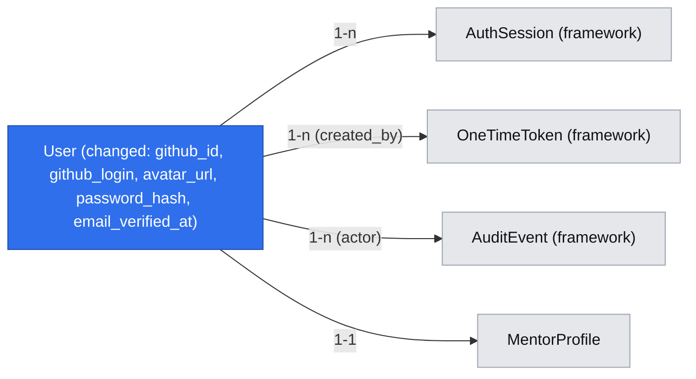

# Accounts & Roles — GitHub sign-in, email fallback, role screens (E01)

> Source: epic #15 — stories #20 (E01-S01), #21 (E01-S02), #22 (E01-S03).
> Built on: `.ai/specs/2026-10-20-access-framework.md` (P1–P9, F1–F5) — read it first;
> this spec only describes what is unique to signing in and role separation.
> Design authority: `.ai/specs/product-brief.md`.

## 📝 TLDR

Mentees and invited mentors cannot sign in today, and every screen is open. **Proposed
(future behavior):** "Sign in with GitHub" first, email + password second; each user lands
on their role's home (`/home` mentee, `/mentor` mentor, `/admin` operator); wrong-role
screens redirect home; the operator role belongs only to the founders' allowlisted
emails. Every access rule is a declaration in the framework's policies — this feature is
its first consumer and its reference example.

## 📝 Problem Statement

No booking, mentor page, or operator action can be tied to a person (#15 evidence: the
mentee "half a day, and I still don't trust that code", 2026-08-20; the mentor "two
evenings a month, for free", 2026-08-22). D07 makes GitHub the primary sign-in because
"my GitHub is my profile"; R07 forbids open mentor registration; D19 makes the two
founders the only operators.

## 📝 Non-goals

- Changing a user's email after creation (`users.email` is immutable in 1.0; the
  operator allowlist matches the account's stored email).
- Self-service mentor registration or any "become a mentor" path (R07). Until E02-S01
  ships, the `mentor` role is assigned only by hand in the database (known Phase 1
  limitation); E02-S01's invitation acceptance is the sole production path.
- Operator-specific session lifetimes: sessions follow the framework constants
  (`SESSION_IDLE_TTL = 24h`, `SESSION_ABSOLUTE_TTL = 7d`) for every role.
- A "sign out" route of our own: the framework's `POST /api/auth/sign-out` is used.

## 📝 Proposed Solution

| Gate | Decision applied here |
|---|---|
| Q3 single role | One effective role per request: stored `users.role` (`mentee`/`mentor`), overridden to `operator` by the founders' allowlist. A founder who also mentors uses a second account. |
| Q4 | Code and copy say **mentee**. |
| Q5 | Sign-in creates a DB session via `SessionService.create` (framework P1). |
| Q6 | In-house: `bcryptjs` (cost 12) + an `OAuthProvider` port with a `fetch`-based GitHub adapter (configurable endpoints so tests use a fake GitHub server; `arctic` can replace the adapter internals later without touching callers). |
| Q9 | Registration answers generically ("check your inbox"); the duplicate-email refusal and "use GitHub sign-in" hint go **by email** to the address owner. |

**Registration sets the password after email verification** (not at submit). Storing a
password on an unverified account allows *pre-account-takeover*: an attacker registers
the victim's email with the attacker's password, the victim later verifies and inherits
it. Choosing the password on the verification page means only the mailbox owner ever
sets one, and no unverified `users` rows exist. #21's criterion ("registers with email
and password and confirms") still holds; only the order of the two fields changes.

Alternatives: password at submit + "last registration wins" (lost: still hijackable
between two registrations); magic-link-only sign-in (lost: D07 names email + password).

## 📝 Architecture

New in `core`: `services/auth/oauth/{oauth-provider.port,github.adapter}.ts`,
`services/auth/password.service.ts`, `services/auth/sign-in.service.ts` (orchestrates
identity → user → session; routes stay thin), `services/auth/operator-allowlist.ts`,
`validators/auth/{register,login,complete-registration}.schema.ts`, mail builders under
`services/auth/mail/`. `UserService` gains `findOrCreateFromGithub`, `createVerified`.
`app` gains routes under `api/auth/`, pages under `(auth)`, `(mentee)`, `(mentor)`, and
guards `admin/`. All checks use framework primitives — no hand-written role `if`s.

## 📝 Data Model

Migration `accounts-identity` (additive, `up` + `down`) on `users`:

| Column | Type | Notes |
|---|---|---|
| `github_id` | varchar, unique, null | GitHub numeric id as string; stable across login renames. |
| `github_login` | varchar, null | Display / profile link (D07). Refreshed each sign-in. |
| `avatar_url` | varchar, null | Refreshed each sign-in. |
| `password_hash` | varchar, null | bcrypt cost 12. Null for GitHub-only users. |
| `email_verified_at` | timestamptz, null | Set by GitHub (verified primary email) or by the verification link. |

Emails are stored trimmed + lower-cased (schema transform); the existing seeded value is
already lower-case. The GitHub access token is used once to read the identity and is
never stored.

Interactive view: `.ai/data-model/2026-10-20-accounts-and-roles.html`.

### Configuration (BC §4 — all optional or defaulted)

| Variable | Default | Missing value behavior |
|---|---|---|
| `GITHUB_CLIENT_ID`, `GITHUB_CLIENT_SECRET` | — | GitHub button shown disabled with "GitHub sign-in is not configured"; routes answer 503 `service_unavailable` (new additive code, `ServiceUnavailableError`). Never fails boot. |
| `GITHUB_OAUTH_BASE_URL` | `https://github.com` | — (harness points it at the fake server) |
| `GITHUB_API_BASE_URL` | `https://api.github.com` | — |
| `OPERATOR_EMAILS` | empty | Comma-separated, normalised; empty = no operator. |

## 📝 API Contracts

All routes use `secureRoute` (framework P4); `dynamic = 'force-dynamic'`.

| Route | Access · CSRF · rate limit | Input → output |
|---|---|---|
| `GET /api/auth/github` | public · n/a (GET) | `?returnTo` → 302 to GitHub with `state` and a **required S256 PKCE** challenge; sets `devmentor_oauth` cookie (`state`, PKCE verifier, validated `returnTo`; httpOnly, lax, 10 min, `path=/api/auth/github`). Scopes `read:user user:email`. |
| `GET /api/auth/github/callback` | public · `state` must equal the cookie on **every** path, including `error=access_denied` | Cookie cleared on every terminal path (state single-use). `access_denied` → 302 `/sign-in?cancelled=1`, nothing created. Else exchange with the verifier → identity → `SignInService.github` → Set-Cookie session → 302 to the re-validated `returnTo` or `ROLE_HOME[role]`. Failures (state mismatch/replay, verifier rejected, GitHub error) → 302 `/sign-in?error=github \| github-email \| github-conflict`. |
| `POST /api/auth/register` | public · CSRF · `auth.register` | `{ email, displayName, returnTo? }` → on successful synchronous delivery, `{ status: 'check-inbox' }` for every email state; delivery failure → generic 503 for every email state. |
| `POST /api/auth/complete-registration` | public · CSRF · `auth.token-consume` | `{ token, password }` → new/linkable account: `{ redirectTo }` + Set-Cookie; stale link for an account that already has a password: `{ redirectTo: '/sign-in' }` without a cookie. |
| `POST /api/auth/login` | public · CSRF · `auth.login` | `{ email, password, returnTo? }` → `{ redirectTo }` + Set-Cookie, or 401 `unauthorized` "Invalid email or password". |
| `GET /api/users` | `auth.user.list` (operator) | unchanged `UserDto[]` — **now operator-only** (BC §1 breaking). |
| `POST /api/users` | `auth.user.create` (operator) | unchanged. |
| `GET /api/users/[id]` | `auth.user.read` (operator, or self) | `UserDto` — new; the wrong-owner item-read probe. |

Schemas: `email` = trimmed lower-cased email ≤ 254; `displayName` 1–120; `password` 12–72
**bytes** UTF-8 (bcrypt silently truncates beyond 72 bytes — refuse instead);
`returnTo` = framework `returnToSchema`. `UserDto` gains optional `role`, `githubLogin`,
`avatarUrl` (additive).

### Sign-in rules (`SignInService`)

**GitHub** (`identity = { githubId, login, name, avatarUrl, primaryVerifiedEmail }`):

1. No verified primary email → `github-email` ("Add a verified email on GitHub or use email sign-in").
2. User with `githubId` → refresh login/avatar → session.
3. Else user with that email: if it has a different `githubId` → `github-conflict`;
   else link (`githubId`, `emailVerifiedAt ??= now`); if the account was unverified
   (the registration flow cannot produce one, but seeded/pre-existing rows with
   `email_verified_at = NULL` are treated exactly this way), clear `passwordHash` and
   `revokeAllForUser`. Audit `auth.user.github-linked`, and mail the address owner
   "GitHub was linked to your account" (no sign-in link).
4. Else create `{ role: 'mentee', displayName: name ?? login, emailVerifiedAt: now }`,
   emit `auth.user.created` (`+ method: 'github'`, additive payload field).

**Registration** sends exactly one mail in every branch and returns the same successful
response only after synchronous delivery succeeds. A delivery failure returns the same
generic 503 regardless of email state; any token issued for the unknown-email branch
remains committed so a retry can supersede it safely. `REGISTER_MIN_RESPONSE_MS = 400` is a minimum response
floor measured through the injected `Clock`, not a constant-time guarantee or a security
boundary. Generic responses, equivalent mail delivery, the dummy password hash, and rate
limits are the anti-enumeration controls; tests verify branch timings do not deliberately
short-circuit but do not assert equality across external SMTP latency.

| Email state | Mail sent (tag) |
|---|---|
| unknown | verification link (`auth.verify-email`), token payload `{ displayName, returnTo }` |
| tied to GitHub | "This email signs in with GitHub" + sign-in link (`auth.use-github`) |
| has a password | "You already have an account" + sign-in link (`auth.already-registered`) |

`complete-registration` runs in **one `em.transactional`**:
`consume(em, 'auth.email-verification', token)` → lock and re-read the user by normalized
email → branch:

1. No user exists: create one with `passwordHash`, `emailVerifiedAt = now`, role
   `mentee`.
2. A verified GitHub account exists with no password: attach the password without
   changing its stored role or GitHub identity, and `revokeAllForUser` its existing
   sessions before creating the new one.
3. An account already has a password: do not overwrite it; consume the stale link and
   return the normal sign-in destination without creating a session.

Branches 1 and 2 create the session and audit in the same transaction. Any unexpected
failure rolls back the token consumption and all writes, so the link still works. Branch
3 is an expected terminal state and commits consumption, preventing replay. Successful
account creation/linking redirects to the re-validated `returnTo` or `/home`; branch 3
redirects to `/sign-in`. The `returnTo` carried in the token is what lets an invitation
link (E02-S01, `/invitation/<token>`) finish after either sign-in method. Contract:
auth only carries `returnTo` and signs in the mailbox owner as the account of that
email; matching the account's email to the invitation's email is E02-S01's
responsibility.

**Rate limits (`auth.register`):** two independent limits — per IP (5 requests/hour)
and per target address (3 mails/hour, one shared counter for all three email states so
the limit never reveals account state). Exceeding either returns the framework 429.

When `mailer.isDeliverable` is false (transport `log`), `/register` and the "Create an
account with email" link show "Email sign-up is not available yet — use GitHub" instead
of a form that would dead-end.

**Password login:** unknown email or no hash → compare against a constant dummy hash
(equal timing) → 401; wrong password → 401; audit `auth.signin.failed`
(`{ method, reason }`, target user id when known, never the typed email or password).

**Operator allowlist** (`operator-allowlist.ts`, D19/R18): registered as the framework's
`roleResolver` — the effective role is `operator` when the user's verified email is on
`OPERATOR_EMAILS`, otherwise the stored `users.role`. The framework Data Model section
is authoritative for why `operator` is never stored: removing a founder from the list
restores their stored role with no data loss. The list is parsed once at boot; changing
it means editing the environment and restarting (the founders' by-hand action, logged
in the operator note per R18). Until the restart a removed founder keeps operator
rights; the same by-hand procedure also calls `revokeAllForUser` for them. After the restart the change applies on the very next
request of every live session, because the role is resolved per request. Operator
sign-ins are visible in the audit trail through
`auth.session.created` (`{ method, role: 'operator' }`). No stored role, route, page, or
seed can assign `operator`; policies only recognize the effective role returned by the
resolver.

## 📝 UI/UX

Public auth pages use Tailwind; forms use `CrudForm`; states use `feedback/*`.

- **`/sign-in`**: "Sign in with GitHub" is the first, primary control; the email form
  second; a "Create an account with email" link. Messages: `cancelled=1` → "GitHub
  sign-in was cancelled. No account was created."; `github-email`, `github-conflict`,
  `github` → plain-language error. A signed-in visitor is redirected to their home.
- **`/register`** → email + display name → "Check your inbox" (same text for every
  case). No password field here (see Proposed Solution).
- **`/verify-email?token=`** → server `peek` → "Choose a password" (password +
  confirm) → signed in → home. Invalid/expired → "This link is invalid or has expired"
  + link to `/register`. `Referrer-Policy: no-referrer` on this page (token in URL).
- **Role homes**: `(mentee)/home`, `(mentor)/mentor` — placeholders with the user's
  name, avatar (if any), a `RoleNav`, and sign-out. `/admin` keeps its URLs, headings,
  and links (integration tests assert them) and becomes the operator workspace.
- **Wrong role** → silent redirect to own home (no "forbidden" page); **expired session**
  → `/sign-in?returnTo=…` before any user data renders (layout **and** page guards).
- No "become a mentor" link or route exists anywhere (R07).
- Accessibility: one `h1` per page; errors in `role="alert"`; the GitHub control is a
  real link (works without JS); focus moves to the first invalid field on 422.

## 📝 Edge Cases & Failure Scenarios

| Scenario | What the user sees |
|---|---|
| User cancels on GitHub | `/sign-in` with "cancelled, no account created"; no row, failure audited. |
| `state` cookie missing/mismatched (expired, CSRF attempt) | `/sign-in?error=github`; nothing created. |
| GitHub down / token exchange fails | `/sign-in?error=github`; error logged with no code/token. |
| GitHub account without verified email | `github-email` message. |
| User declines the `user:email` scope on GitHub | `github-email` message (no emails readable); nothing created. |
| GitHub email belongs to an account linked to another GitHub id | `github-conflict` message. |
| GitHub not configured (local dev) | Disabled button + note; 503 on direct route call. |
| Register an existing email | "Check your inbox"; owner gets the right hint by mail. |
| Verification link clicked twice / in two tabs | First wins; second sees "invalid or expired". |
| Verification link after a GitHub sign-in created the account | Treated as link: password attached only if the account has none; signed in. |
| Password > 72 bytes | 422 on the field. |
| Brute force on `/login` | 429 + "Try again in N minutes". |
| Founder removed from `OPERATOR_EMAILS` | After the restart, their next request resolves to their stored role; `/admin` redirects them home. |
| OAuth `state` replayed or verifier mismatched | `/sign-in?error=github`; nothing created. |
| Mentee opens `/mentor` or `/admin` | Redirected to `/home`. |
| Mentee calls `GET /api/users/<other id>` | 403 `forbidden`. |
| Mail transport fails | The same generic 503 and "We couldn't send the email. Try again." message for every email state; any issued token remains committed and no success response is returned. |

## 📝 Risks & Impact Review

- **BC §1 breaking:** `/api/users` stops being public. The client (`/admin/users`) moves
  behind the operator guard and `admin.integration.test.ts` signs in first — same PR,
  listed under "Breaking changes".
- **BC §3:** additive columns; `down` drops them (GitHub links and passwords lost —
  users would need to re-register; stated in the PR rollback plan).
- **BC §4/§6:** new optional variables; additive `method` payload field.
- **Registration order** (password after verification) is a UX deviation from the
  literal story text, chosen for security. Founder A's acknowledgement is a **blocking
  precondition for starting Phase 2**; there is no plan B — a refusal means revising
  this spec (the alternative is open to pre-account-takeover).
- **Password reset is in scope** (Phase 2, step 17): a forgotten password must not be a
  dead end for invited email-only mentors. Phase 2 is complete only with reset and a
  production `SMTP_URL`.
- **Invitations before Phase 2:** until email sign-in works, invitations may go only to
  people with a GitHub account — a stated precondition of E02-S01.
- **GitHub PKCE** is confirmed by GitHub's OAuth-apps docs
  (<https://docs.github.com/en/apps/oauth-apps/building-oauth-apps/authorizing-oauth-apps>:
  `code_challenge` / `code_challenge_method`); step 3 re-checks at implementation time.
- **Real mail transport:** the framework's `smtp` adapter makes the provider a
  configuration choice; Phase 2 is only *complete* when a production `SMTP_URL` is
  configured (founder A picks the provider, #21 open question; D16 timing). Until then
  email sign-up is visibly disabled, not broken.
- **GitHub PKCE (S256) is required**, with no runtime fallback (a fallback would be a
  silent downgrade). Step 3 confirms GitHub's OAuth-app PKCE support against current
  GitHub docs before coding; if unsupported, this spec is revised — not worked around.
- `risk-high`, `needs-qa`, second reviewer (auth, sessions, roles — `SDLC.md`).

## 📝 Decisions in play

- **D07 / R06** (founder A) — GitHub first, email fallback: implemented.
- **R07 / D08** — invitation only: no self-service mentor route; `returnTo` carry-through
  prepared for E02-S01.
- **D19 / R18** (both founders) — operator by allowlist only; changes by hand.
- **D05** (founder A) — accounts and roles are part of 1.0.
- Proposed acknowledgement (not a supersede): #21's field order (see Risks).

## ✅ Acceptance criteria (from #20–#22, with verification)

| Criterion | Verified by |
|---|---|
| GitHub sign-in creates/finds the account and lands on mentee home (#20) | integration (fake GitHub) |
| Invited mentor's GitHub sign-in lands on mentor home (#20) | integration (role set in harness DB) |
| Cancelled GitHub authorisation creates nothing, says so (#20) | integration |
| Expired session → sign-in, nothing shown first (#20) | integration + `requirePageAccess` unit |
| GitHub first, email second on every sign-in screen (#20) | integration (accessibility-tree order) |
| Email user registers, confirms, lands on mentee home (#21) | integration (outbox link) |
| Wrong password → generic message, no session (#21) | integration + unit |
| GitHub-tied email registration refused, pointed to GitHub (#21, via email per Q9) | unit (mail tag) + integration (outbox) |
| Invited email-only mentor completes with password (#21) | `returnTo` carry-through unit here; end-to-end in E02-S01 |
| Mentee refused on mentor screens; mentor refused on operator screens (#22) | integration |
| Founders hold operator; nobody else can be granted it (#22) | unit (allowlist resolver) + integration |
| A caller cannot read another user's row (#22 item-ownership portion) | integration on `/api/users/[id]` |
| No way to become a mentor (#22) | integration (no link) + route-access lint rule |
| Forgotten password can be reset by mail; old sessions revoked (Phase 2, step 17) | unit + integration (outbox link) |
| `/api/auth/register` is rate-limited per IP and per target address, identically for every email state | unit (429, shared counter) |
| Linking GitHub to an existing account mails its owner | unit (mail tag) |

## 📋 Phasing

Framework prerequisites per phase are in the framework spec's dependency matrix.

1. **Phase 1 — GitHub sign-in, operator, and guards (#20 + the guard half of #22).**
   Real accounts start existing here, so `/api/users` and `/admin` become operator-only
   in the **same** phase — no window where real emails are public.
2. **Phase 2 — Email + password (#21) and password reset.** Starts only after founder A
   acknowledges the registration-order change; complete only with a production
   `SMTP_URL` and the reset flow.
3. **Phase 3 — Item-ownership probe and role scenarios (rest of E01's #22 scope).**
   Scoped collection behavior is accepted and tested by the first real collection in
   E03-S04 (#31), not claimed through an item endpoint here.

## 📋 Implementation Plan

Same per-step rules as the framework spec (tests next to source, `coverage.include`,
gate green). Pages and layouts get `*.test.tsx` too: async server components are
invoked as functions with mocked `requirePageAccess`/`cookies()` and the returned tree
is rendered with Testing Library (each redirect, message, and disabled state is a
branch). Integration scenarios live in `tests/integration/` and own their data.

**Phase 1 — GitHub sign-in, operator, and guards**

1. Migration `accounts-identity` (all five columns, so later phases add no migration);
   entity + `UserDto` additive fields; `up`/`down` exercised.
2. Env: GitHub variables + `OPERATOR_EMAILS` in `env.ts`, `.env.example`, `README.md`,
   CI, harness; `ServiceUnavailableError` (503) in `errors.ts` + BC §1 text.
3. Confirm GitHub OAuth-app PKCE (S256) support in current GitHub docs (stop and revise
   the spec if absent). `oauth-provider.port.ts` + `github.adapter.ts` (authorize URL,
   state + PKCE, code exchange, `/user` + `/user/emails`). Unit tests with mocked
   `fetch`: happy path, denied, no verified email, non-200s, verifier sent.
4. `tests/integration/fake-github.ts`: random-port HTTP server implementing the three
   endpoints with a configurable identity and PKCE verification; harness sets the
   base-URL variables.
5. Register the `auth.signin.failed` audit metadata schema, then implement
   `UserService.findOrCreateFromGithub` + `SignInService.github` (rules 1–4, audit,
   event). Unit tests for every branch incl. conflict, cancellation/failure audit
   content, and the defensive unverified link.
6. `operator-allowlist.ts` registered as `roleResolver`. Unit tests: listed, unlisted,
   unverified email, case/whitespace normalisation, empty list.
7. Routes `api/auth/github` + `callback`. Unit tests: cancelled (with and without valid
   state), state mismatch/replay, cookie cleared on every path, unconfigured 503,
   success redirect by role and by `returnTo`, hostile `returnTo` ignored.
8. Access switch-over: `user.policy.ts` gains `auth.user.create`;
   `/api/users` verbs → operator actions; `admin/layout.tsx` and each admin `page.tsx`
   → `requirePageAccess('auth.area.operator', { returnTo })`. BC §1 "Breaking changes".
9. Pages `(auth)/sign-in` (GitHub first; email form disabled "coming soon" until
   Phase 2), `(mentee)/home`, `(mentor)/mentor` with layouts + pages calling
   `requirePageAccess('auth.area.mentee', ...)` or
   `requirePageAccess('auth.area.mentor', ...)`, rendering `SessionProvider` +
   `RoleNav` + sign-out; no mentor-onboarding link anywhere.
10. Integration: update `admin.integration.test.ts` (harness `OPERATOR_EMAILS` + fake
    GitHub identity for the operator, then the existing heading/cell assertions);
    `auth-github.integration.test.ts`: new mentee lands on `/home`; harness sets a user
    to `mentor` → `/mentor`; cancel path; expired session (harness expires the row) →
    sign-in with nothing rendered first; control order on `/sign-in`; anonymous
    `GET /api/users` → 401. Screenshots at each assertion.

**Phase 2 — Email + password**

11. Add pinned `bcryptjs` to `packages/core`; `password.service.ts` (`BCRYPT_COST = 12`
    with rationale, dummy-hash compare). Tests.
12. Schemas `register`, `complete-registration`, `login` (72-byte rule). Tests.
13. Register the `auth.email-verification` token purpose (24 h TTL and payload schema);
    add mail builders (`verify-email`, `use-github`, `already-registered`);
    `SignInService.register` (minimum response floor, one mail per branch),
    `completeRegistration` (single transaction), `password`. Unit tests: each branch's
    tag and identical successful response, generic delivery-failure 503, response floor
    with `FixedClock`, rollback keeps the token live, each locked concurrent-user
    branch, generic 401, failure audit content.
14. Routes `register`, `complete-registration`, `login` with rate-limit policies.
    Unit tests incl. 429 and `isDeliverable=false`.
15. Pages `/register`, `/verify-email` (`Referrer-Policy: no-referrer`); enable the
    email form on `/sign-in`.
16. Integration `auth-password.integration.test.ts`: register → outbox link → choose
    password → `/home`; wrong password generic, no cookie; register a GitHub-tied email
    → generic screen + `auth.use-github` mail in outbox.
17. Password reset: `auth.password-reset` token purpose, `SignInService.requestReset`
    / `resetPassword` (generic response for every email state, `revokeAllForUser` on
    success), routes + `/forgot-password` and `/reset-password` pages, rate limits,
    unit tests and an integration scenario (request → outbox link → new password →
    old sessions revoked).

**Phase 3 — Item-ownership probe and role scenarios**

18. `GET /api/users/[id]` (`auth.user.read`: operator, or self via the policy's typed
    item predicate). Unit tests.
19. `roles.integration.test.ts`: mentee → `/mentor` and `/admin` redirected home;
    mentor → `/admin` redirected home; mentee `GET /api/users/<other>` 403 and self
    200; an app restarted without the founder's email on `OPERATOR_EMAILS` → that
    account lands on its stored-role home.
20. Move this spec and the framework spec to `.ai/specs/implemented/` only after
    `npm run test:unit:coverage` and the integration suite pass and the PRs merge;
    add a lesson to `.ai/lessons.md` if any gotcha surfaced.
